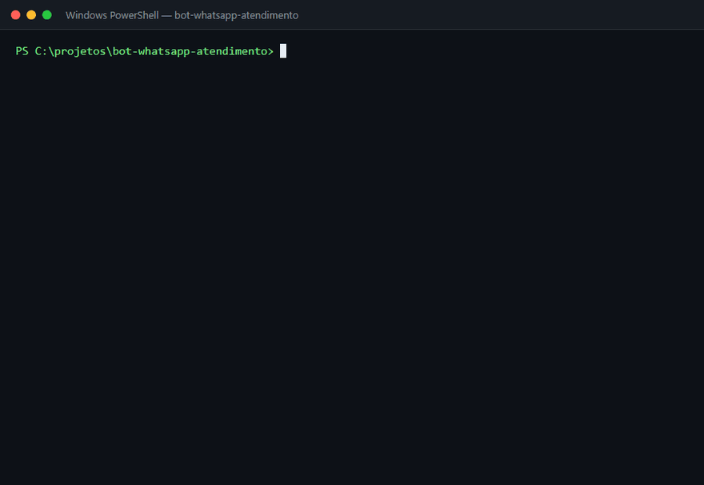

# Bot de Atendimento para WhatsApp

Chatbot para a **Doce Encanto Confeitaria** (loja fictícia), feito em Python com a **API oficial do WhatsApp (Meta Cloud API)**. Responde por menu numérico e por palavra-chave, e avisa quando a loja está fechada.



*Conversa real com o bot pelo simulador (`simulador.py`): primeiro com a loja aberta, depois fora do horário.*

## Problema

Uma confeitaria pequena recebe dezenas de mensagens por dia no WhatsApp, e quase todas são as mesmas perguntas: *quanto custa?*, *vocês entregam?*, *aceita Pix?*, *que horas abre?*. A dona para a produção toda hora para responder, e mensagens que chegam à noite ficam sem resposta até o dia seguinte.

## Solução

Um bot que atende na hora, 24 horas por dia:

- **Menu de opções**: o cliente digita `1` a `6` (cardápio, encomenda, entrega, pagamento, endereço, atendente).
- **Palavras-chave**: entende frases soltas como *"aceita pix?"* ou *"vocês entregam no meu bairro?"*, com ou sem acento, maiúscula ou pontuação.
- **Fora do horário**: informações simples (cardápio, preços, entrega, pagamento, endereço) continuam respondendo; encomendas e pedidos de atendente recebem o aviso de loja fechada com o horário.
- **Passa para um humano** quando o cliente pede um atendente.

## Resultado

- As perguntas repetidas são respondidas **em segundos**, sem a dona largar o que está fazendo.
- Cliente que manda mensagem às 23h recebe o cardápio na hora em vez de esperar até o dia seguinte.
- A dona só entra na conversa quando é encomenda ou quando o cliente pede.

## Como funciona

```
Cliente no WhatsApp ──► Meta Cloud API ──► webhook (app.py) ──► bot/respostas.py
         ▲                                                              │
         └──────────────────── resposta pela API ◄──────────────────────┘
```

| Arquivo | O que faz |
|---|---|
| `bot/respostas.py` | Regras do atendimento: menu, palavras-chave, horário. Só texto entra e texto sai. |
| `app.py` | Servidor Flask que recebe o webhook da Meta e envia a resposta. |
| `simulador.py` | Conversa com o bot pelo terminal, sem precisar da Meta. |
| `tests/` | Testes automatizados com pytest. |

## Como rodar

Precisa do [Python 3.10+](https://www.python.org/downloads/).

```bash
pip install -r requirements.txt
```

### 1. Testar no terminal (sem configurar nada)

```bash
python simulador.py
python simulador.py --fechado   # simula a loja fechada
```

### 2. Rodar os testes

```bash
pytest
```

### 3. Ligar no WhatsApp de verdade (grátis, com o número de teste da Meta)

1. Crie um app em [developers.facebook.com](https://developers.facebook.com/) do tipo **Business** e adicione o produto **WhatsApp**.
2. Em **WhatsApp > API Setup**, copie o **token temporário** e o **Phone number ID**. Cadastre o seu celular como destinatário de teste.
3. Copie `.env.example` para `.env` e preencha os valores.
4. Rode o servidor: `python app.py`
5. Exponha a porta 5000 para a internet com o [ngrok](https://ngrok.com/): `ngrok http 5000`
6. Em **WhatsApp > Configuration**, cadastre o webhook `https://SEU-ENDERECO.ngrok-free.app/webhook` com o mesmo `VERIFY_TOKEN` do `.env` e assine o campo **messages**.
7. Mande "oi" do seu celular para o número de teste.

## Tecnologias

Python · Flask · WhatsApp Cloud API · pytest

## Próximos passos

- Guardar o estado da conversa para montar a encomenda passo a passo
- Enviar mensagens com botões (mensagens interativas da API)
- Notificar a dona no celular quando o cliente pedir um atendente
